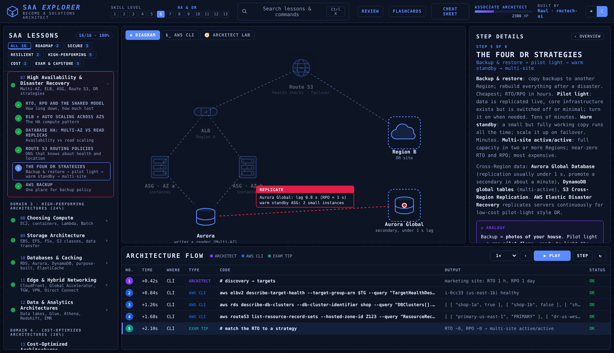

# 🧭 SAA Explorer — Become an AWS Solutions Architect: SAA-C03 and the roadmap to master architect

An interactive, step-by-step course for the **AWS Certified Solutions Architect – Associate (SAA-C03)** and beyond. It starts with what a Solutions Architect really does and a **complete roadmap to master Solutions Architect** (certifications, soft skills, discovery, Architecture Decision Records, portfolio), then walks all four exam domains: **Secure** (multi-account identity, secure networking, data protection), **Resilient** (decoupling, high availability, disaster recovery), **High-Performing** (compute, storage, databases and caching, edge and hybrid networking, analytics) and **Cost-Optimized**, and finishes with exam technique, migration and a capstone design review. Every lesson animates the architecture, with analogies, memory hooks, trigger words, quizzes, and an **Architect Lab** where you describe a design in YAML and fix it like an exam grader would.

> Created by **Raul** ([@rmctech-ai](https://github.com/rmctech-ai)) · Freelance AI Automation Specialist on the path to Cloud Security.
> Part of the Explorer series: [Linux Explorer](https://github.com/rmctech-ai/linux-explorer) · [Python Explorer](https://github.com/rmctech-ai/python-explorer) · [IAM Explorer](https://github.com/rmctech-ai/iam-explorer) · [VPC Explorer](https://github.com/rmctech-ai/vpc-explorer) · [IaC Explorer](https://github.com/rmctech-ai/iac-explorer) · [Serverless Explorer](https://github.com/rmctech-ai/serverless-explorer) · [CI/CD Explorer](https://github.com/rmctech-ai/cicd-explorer) · [Cloud Security Explorer](https://github.com/rmctech-ai/cloudsecurity-explorer) · [Well-Architected Explorer](https://github.com/rmctech-ai/wellarchitected-explorer) · [Security Journey Explorer](https://github.com/rmctech-ai/aws-security-journey) · [n8n Explorer](https://github.com/rmctech-ai/n8n-explorer) · [Claude Code Explorer](https://github.com/rmctech-ai/claudecode-explorer).
> 🏠 Part of **[Raul's Cloud Learning Hub](https://rmctech-ai.github.io/)** · Live course: https://rmctech-ai.github.io/SAA-Explorer/
> The Explorer course format is inspired by [Protocol Explorer](https://protocol-explorer-alpha.vercel.app/) by Dilum Sanjaya. All lessons, labs and study tools are my own work.



---

## ▶ Run it

No build step. Plain HTML/CSS/JS.

```bash
python3 -m http.server 8000     # then open http://localhost:8000
```

### Publish on GitHub Pages
```bash
git init && git add . && git commit -m "SAA Explorer"
git branch -M main
git remote add origin https://github.com/rmctech-ai/SAA-Explorer.git
git push -u origin main
```
GitHub → **Settings → Pages → Deploy from a branch → `main` / root → Save** → `https://rmctech-ai.github.io/SAA-Explorer/`

---

## 🧭 How to use it

| Area | What it does |
|---|---|
| **Lessons** (left) | 16 lessons grouped by track. Click to expand steps. Dots show progress. |
| **Diagram** tab | Animated scene for every step. |
| **$_ AWS CLI** tab | Types out real commands/code for the step with realistic output. |
| **🧭 ARCHITECT LAB** tab | **Architect Lab**: describe a design in YAML (40 component types such as `alb`, `nlb`, `aurora`, `dynamodb`, `sqs`, `kinesis`, `efs`, `fsx`, `vpce`, `transitgateway`, `directconnect`, `cognito`, `redshift`), add workload requirements (`ordering`, `rto_minutes`, `on_prem`, `shared_files`, `protocol`, `analytics`…) and press RUN REVIEW. The lab grades it like an SAA exam grader plus a Well-Architected reviewer: high, medium and low risk issues, a fix for each, and a score per pillar. Each challenge is an exam-style scenario. |
| **Step Details** (right) | Explanation, **Analogy**, **Memory Hook**, **Trigger Words**, real-world notes, warnings. |
| **Architecture Flow** (bottom) | Log of every command so far with type, output and status. |
| **XP & levels** | Earn XP for steps, lessons, quizzes and challenges. Saved in your browser. |
| **Cheat Sheet** | Master hooks + key syntax for every lesson (also [`CHEATSHEET.md`](CHEATSHEET.md)). |

**Keyboard:** `→` / `←` steps · `Space` play · `Ctrl+K` search · `Esc` close.

---

## 📚 Curriculum (16 lessons · 86 steps · 64 quiz questions · 16 hands-on challenges)

| # | Lesson | Track | You'll learn |
|---|---|---|---|
| 01 | The Solutions Architect & SAA-C03 ⚑ | ROADMAP | What an SA does, and what the exam tests |
| 02 | Roadmap to Master Solutions Architect ⚑ | ROADMAP | Certs, skills, soft skills, portfolio |
| 03 | Multi-Account Strategy & Identity ⚑ | SECURE | Organizations, SCPs, Identity Center, roles, Cognito |
| 04 | Secure Network Design ⚑ | SECURE | VPC tiers, SG vs NACL, endpoints, WAF, Shield |
| 05 | Data Protection ⚑ | SECURE | KMS, Secrets Manager, ACM, Macie, S3 security |
| 06 | Decoupled Architectures ⚑ | RESILIENT | SQS, SNS, EventBridge, Step Functions, Kinesis |
| 07 | High Availability & Disaster Recovery ⚑ | RESILIENT | Multi-AZ, ELB, ASG, Route 53, DR strategies |
| 08 | Choosing Compute ⚑ | HIGH-PERFORMING | EC2, containers, Lambda, Batch |
| 09 | Storage Architecture ⚑ | HIGH-PERFORMING | EBS, EFS, FSx, S3 classes, data transfer |
| 10 | Databases & Caching ⚑ | HIGH-PERFORMING | RDS, Aurora, DynamoDB, purpose-built, ElastiCache |
| 11 | Edge & Hybrid Networking ⚑ | HIGH-PERFORMING | CloudFront, Global Accelerator, TGW, VPN, Direct Connect |
| 12 | Data & Analytics Architectures ⚑ | HIGH-PERFORMING | Data lakes, Glue, Athena, Redshift, EMR |
| 13 | Cost-Optimized Architectures ⚑ | COST | Purchase options, right-sizing, storage and network costs |
| 14 | How to Read SAA Questions ⚑ | EXAM & CAPSTONE | Keywords, distractors, time strategy |
| 15 | Migration & Modernization ⚑ | EXAM & CAPSTONE | The 7 Rs, MGN, DMS, SCT, Migration Hub |
| 16 | Capstone: Full Design Review ⚑ | EXAM & CAPSTONE | All four domains on one architecture |

⚑ = has a hands-on challenge.

## 🎯 Study plan & capstone

- **Weeks 1–2:** Lessons 1–5 (the SA role, the master roadmap, identity, secure networking, data protection).
- **Weeks 3–5:** Lessons 6–7 (decoupling, HA and DR), plus hands-on builds in a free-tier account.
- **Weeks 6–9:** Lessons 8–12 (compute, storage, databases, edge and hybrid, analytics).
- **Week 10:** Lesson 13 (cost).
- **Weeks 11–12:** Lessons 14–15 (exam technique, migration).
- **Weeks 13–16:** Timed practice exams (review every explanation, keep a mistake log) and the Lesson 16 capstone.

**Book the exam** when you score 80%+ on two full practice exams in a row. **Capstone:** publish the Raul Shop design (diagram, ADRs, cost estimate, Architect Lab review) as your first portfolio piece.

## License
MIT © 2026 Raul (rmctech-ai)
